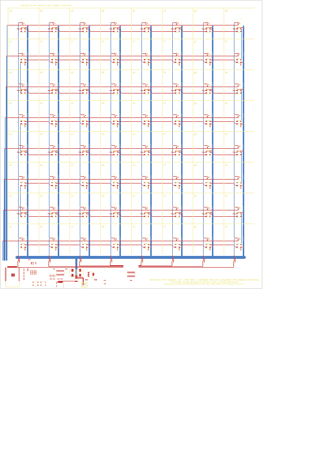

# OpenChess PCB redesign

A complete, single-PCB redesign of the OpenChess smart chess board
(https://joojoooo.github.io/OpenChess/) that keeps **100 % firmware
compatibility** with upstream (including the pre-built binaries), while
replacing the hand-wired "plastic PCB" + perfboard with one assembled board.



## What is on the board

- 8 x 8 squares, **40 mm pitch** (parametric), board 340 x 374 mm, 2 layers.
- Per square: one SOT-23 Hall switch at the square centre (under a 12 mm iron
  disc, silkscreen circle marks it), one WS2812B 5050 LED 9 mm below the
  centre, one 100 nF decoupling cap.
- Column drive: 74HCT595 -> 8 x 1k -> 8 x S8550 PNP high-side switches, one
  under each file, feeding switched +5V up a dedicated trace (same scheme as
  upstream, `SR_INVERT_OUTPUTS = PNP`).
- Rows: sensor open-collector outputs wired-OR per rank, 10k pull-up to 3.3 V,
  straight to the ESP32 GPIOs used by the upstream defaults.
- Controller strip (bottom 42 mm): ESP32-WROOM-32E, CH340C USB-UART with the
  DevKitC auto-reset circuit, RESET/BOOT buttons, AMS1117-3.3, USB-C
  (5 V/3 A, 5.1k CC pull-downs, 3 A polyfuse), optional JST-XH 5 V/4 A input,
  2 x 470 uF bulk, 74AHCT1G125 level shifter for the LED data.
- Power distribution: a 4 mm +5V bus along the strip (B.Cu) and a 2 mm vertical
  +5V bus per file; GND pours on both layers stitched with vias at every square
  corner.
- GPIO map = upstream defaults, so the firmware needs no changes:
  LED IO32, SR SER IO33, SRCLK IO14, RCLK IO26, rows IO4,16,17,18,19,21,22,23.

Folder layout:

```
openchess-redesign/
  AUDIT.md           audit of the upstream project
  README.md          this file
  ORDERING.md        how to order at JLCPCB / PCBWay, cost notes, assembly notes
  hardware/          KiCad 7 project: .kicad_pro / .kicad_sch / .kicad_pcb (+ DRC report)
  manufacturing/     gerber zip, drill, JLCPCB BOM + CPL, BOM.md, PDFs
  tools/             generators (everything above is produced from design.py)
  docs/img/          previews
  build.sh           regenerate everything
```

## Regenerating / changing the design

Everything is generated from `tools/design.py` (parts, nets, placement) by
Python scripts that drive KiCad's `pcbnew` module and `kicad-cli`.

KiCad versions: the files were produced with KiCad 7.0.11 (the version
installable in the build container) and use the KiCad 7 file format, which
KiCad 8, 9 and 10 open directly and migrate on save. The scripts detect the
installed version (library paths, API differences, `kicad-cli pcb drc` on 8+)
so you can rebuild with your current KiCad 10 install; the first save from
KiCad 10 will convert the project to the KiCad 10 format.
The matrix routing is scripted; only the controller strip is auto-routed with
Freerouting.

```sh
sudo apt install kicad kicad-symbols kicad-footprints xvfb default-jre   # or any KiCad 8/9/10 install
# Freerouting 1.9.0 jar from https://github.com/freerouting/freerouting/releases
./build.sh /path/to/freerouting.jar
```

Things you will most likely want to change, all at the top of `design.py`:

| Parameter | Default | Note |
|---|---|---|
| `PITCH` | 40.0 mm | Square pitch. 33.33 matches the upstream LED-strip pitch; 45-50 mm for club-size pieces. Board size follows. |
| `SENSOR` | HX3144ESO, pins VCC=1 OUT=2 GND=3 | **Check the datasheet of the exact part you order**; SOT-23 "44E" parts differ between vendors. Any continuous-time open-collector Hall switch in SOT-23 works. |
| `GPIO` | upstream defaults | Only change if you also change the firmware pin config. |
| `STRIP_H`, `MARGIN` | 42 / 10 mm | Controller strip height, grid margin. |

The build verifies the schematic netlist against the model
(`tools/verify_netlist.py`), runs DRC (`tools/drc.py`) and writes
`hardware/openchess-board_drc.rpt`. Opening the project in KiCad and running
"Update PCB from schematic" should report nothing to change.

## Firmware setup on this board

1. Flash the upstream firmware (web flasher or PlatformIO) over the USB-C port
   (CH340C, hold BOOT if needed; the auto-reset circuit normally handles it).
2. In the WebUI "GPIO" section keep the defaults and set the shift-register
   output type to **PNP**.
3. Run the calibration (serial monitor, 115200 baud) once: it learns the LED
   order and the row/column mapping.

## Mechanical notes

- Top plate: anything 3-6 mm thick with a 12.2 mm x 1.2 mm pocket for the iron
  disc centred on each square and a window/diffuser over the LED (9 mm below
  centre). Four 160 x 160 mm printed quadrants fit a 256 mm printer bed.
- The ESP32 antenna overhangs the bottom edge by 6 mm with a copper keep-out
  around it; leave that area of the enclosure free of metal.
- Mounting holes: 7 x M3.

## Known limitations / to verify

- LCSC numbers were filled from memory and are flagged; verify each one in
  the JLCPCB parts library before ordering (see `ORDERING.md`).
- Rotations in the CPL follow KiCad's convention; check the JLCPCB placement
  preview and rotate SOT-23 / SOIC parts if their preview shows pin 1 wrong.
- 2-layer power distribution is sized for about 4 A total LED current; keep
  the firmware brightness sensible or feed 5 V through J2.
